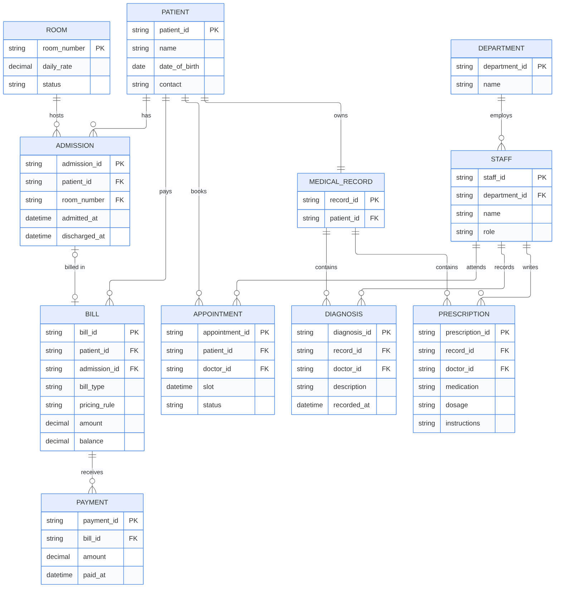

  # SP6 — Database Design (ER Diagram)

   

   11 entities: Patient, Medical Record, Diagnosis, Prescription, Staff, Department, Appointment, Room, Admission, Bill, Payment.
   PK = primary key, FK = foreign key.
